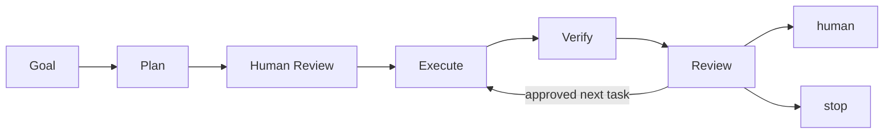
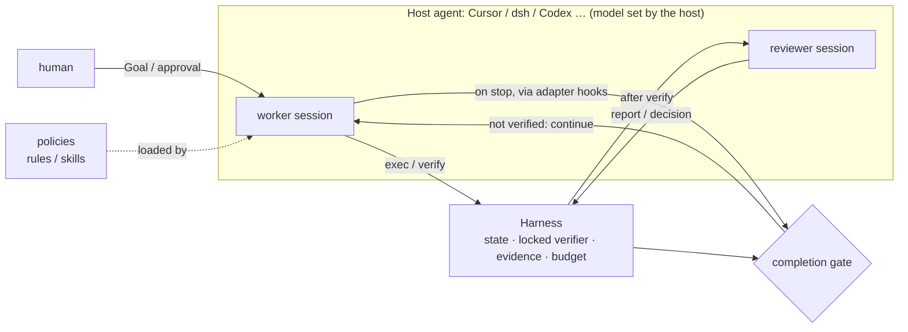

# agent-loop

[中文](README.md) · [Quickstart](docs/quickstart.md) · [Usage](docs/usage.md) · [Related projects](docs/related-projects.md)

[](https://github.com/ZJLi2013/agent-loop/actions/workflows/test.yml)
[](LICENSE)

**An agent for engineering and research: it drives a project through rounds of design, experiment, and verification, and each round's evidence decides the next.**

Verified on **Cursor, Codex, and DeepSeek Harness (dsh)**.

agent-loop has no model of its own. It runs inside a host agent: the host loads its rules and skills,
calls its Harness CLI, and, through the host's hooks, cannot finish a task that is not verified. Use it for iterative experiments, engineering
changes with explicit acceptance criteria, and long tasks that need continuity across context windows.
You define the Goal and project criteria. A worker executes, an independent verifier checks the result,
and an optional reviewer interprets the evidence and proposes the next step.



## How it relates to the host agent



- **Policies (rules / skills)** are working methods written for the host agent, which follows them.
- **Harness** is a CLI the host calls; it owns the state machine and evidence and depends on no host.
- **Adapters** connect a host's lifecycle hooks to Harness: when a session tries to end with the task unverified,
  the host is told to continue. A host without an adapter can still use the policies and CLI (portable mode),
  without that enforced gate.

agent-loop distinguishes only role × host. The model is the host's own provider config; changing it changes nothing in agent-loop.

| Host | Worker | Reviewer |
|---|---|---|
| Cursor | ✅ enforced (stop / memory / preCompact hooks) | — |
| dsh | ✅ enforced (through `hooks-codex`, [known limitations](docs/usage.md#dsh-limitations), Chinese) | ✅ headless, may use a different model from the worker |
| Codex CLI | portable (no enforced gate) | ✅ default reviewer |

The current version targets **0.1.0, an early release**. See [GitHub Releases](https://github.com/ZJLi2013/agent-loop/releases)
for publication status. Configuration and state formats may evolve; changes are recorded in the [changelog](CHANGELOG.md).

## What it provides

- **Incremental planning:** one unverified hypothesis at a time; revision-bound tasks prevent stale plans from driving execution.
- **Execution and verification:** explicit commands run with timeouts, budgets, and logs; a locked project verifier checks results, and workspace changes invalidate verification evidence.
- **Boundary reviews:** an optional reviewer advises on submitted plans and interprets verified task results. The human retains control of Goals and plan approval.
- **Continuity:** project memory, handoffs, and archived records make prior conclusions available to later contexts.
- **Long-task observation and human checkpoints:** heartbeat policies and an optional phone pager.

Tests and experiment metrics belong to the working project. No specific research domain, host, or model is required.

## Try it

Requirements: Python 3.11+, pip, and Git. These commands work in Bash and PowerShell. Use `python3` on Linux
if `python` is unavailable. You can activate your own virtual environment first.

```sh
git clone https://github.com/ZJLi2013/agent-loop.git
cd agent-loop
python -m pip install .
python examples/minimal-project/prepare.py ../agent-loop-demo
cd ../agent-loop-demo
agent-loop-harness init --task t1 --plan-doc plan.md -- python -B -m unittest -v
agent-loop-harness verify
```

The first verification **should fail with exit code 1**: the example incorrectly uses integer division for
an average. Follow the [quickstart](docs/quickstart.md) to inspect the evidence, complete Goal Review,
fix the implementation, and verify again. No API key, model, Cursor installation, or global hooks are needed.

These commands use the default branch. Once the release is published, run `git checkout v0.1.0` before
installing to pin that version. Full host setup is distributed through Git checkout; the Python package
contains the CLI and adapter code.

## Connect your working projects

After trying the CLI, Windows + Cursor users can install the enforced adapter from the repository root:

```powershell
powershell -ExecutionPolicy Bypass -File scripts/sync-to-cursor.ps1
```

The installer creates user-level junctions and hooks, backing up existing ordinary directories with the same
names. Keep the checkout at its installed path, restart Cursor, and make sure Cursor can resolve `python`.
Hooks execute local Python code across workspaces covered by the host; read the [security boundary](SECURITY.md)
before installation. Use `scripts/uninstall-from-cursor.ps1` to remove the integration; restore backups manually.

With [DeepSeek Harness (dsh)](https://github.com/deepseek-ai/deepseek-harness) as the worker, distribute rules and
skills with `scripts/sync-to-dsh.ps1` and wire the hooks per the [usage guide](docs/usage.md#dsh-enforced-mode); models
are configured in dsh, see [configuring your own models in dsh](docs/usage.md#dsh-models) (Chinese). The reviewer calls
Codex CLI through `.agent-loop/reviewer.json` by default and can be switched to dsh headless.

The [usage guide](docs/usage.md) covers project setup, dsh wiring, reviewer configuration, corrections, memory, pager, and upgrades.

## Support and boundaries

| Component | v0.1 scope |
|---|---|
| Harness CLI | Python 3.11+; CI configured for Windows / Ubuntu with Python 3.11 / 3.13 |
| Cursor enforced adapter | Windows + PowerShell 5.1 installer; depends on host lifecycle hooks |
| dsh enforced adapter | Through dsh's `hooks-codex` bridge; `scripts/sync-to-dsh.ps1` distributes rules and skills, hooks are wired by hand, see [setup](docs/usage.md#dsh-enforced-mode) |
| Other hosts | Portable CLI / policies; no guaranteed completion gate |
| macOS/Linux host installer | Not provided yet; CLI support and global host installation are separate |
| Reviewer / pager | Optional configured commands and components, with additional setup |

The Harness controls commands explicitly sent to its runner. Other tool calls remain under the host's
control. The pager cannot wake an exited agent; unattended waiting needs a live session, computer, and
network. Checkpoint and rollback reuse Git without automatically overwriting the working tree.

## Related projects

[Ralph](https://github.com/snarktank/ralph) loops over PRD items, while
[autoresearch](https://github.com/karpathy/autoresearch) runs experiments against a fixed training metric.
agent-loop focuses on planning, project-specific verification, and boundary reviews across research and
engineering projects. See [related projects](docs/related-projects.md) for a sourced comparison including
Aider, mini-swe-agent, OpenHands, and LangGraph. This compares use cases, not benchmark performance.

## Documentation and contributing

| Task | Start here |
|---|---|
| Install and complete the example | [Quickstart](docs/quickstart.md) |
| Use it in a working project | [Usage](docs/usage.md) |
| Understand the architecture | [Design](design.md) (Chinese) · [Policies](skills/README.md) |
| Read research and field experience | [Study map](docs/study/README.md) (Chinese) · [Case studies](case_study/README.md) |
| Find releases and release procedures | [Changelog](CHANGELOG.md) · [v0.1.0 notes](docs/releases/v0.1.0.md) · [Release guide](docs/releasing.md) |
| Report a problem or contribute | [Issues](https://github.com/ZJLi2013/agent-loop/issues) · [Contributing](CONTRIBUTING.md) · [Roadmap](ROADMAP.md) |

Useful reports include installation failures, host compatibility, incorrect completion decisions, repeated
work, and review overhead. Include a minimal reproduction and the relevant versions.
AI-assisted contributions follow [AI_POLICY.md](AI_POLICY.md). Report vulnerabilities through the
[private channel](SECURITY.md), rather than a public issue.

Apache-2.0. See [LICENSE](LICENSE).
