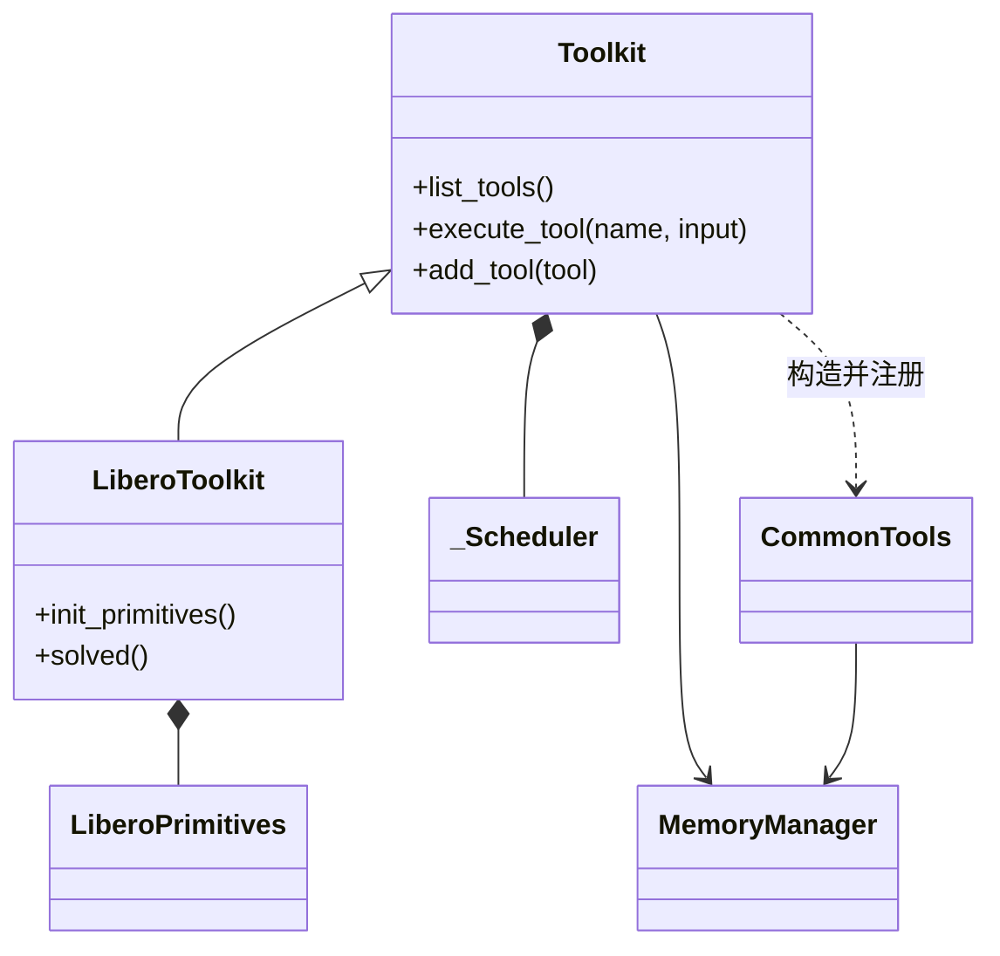

# Code → Class Diagram

回答「这个类持有谁、继承谁、对外给什么 API」。读者要拿着图去读代码，所以**图上每个类名、
方法名、每条边都必须能在源码里 grep 到**；推不出来的关系不画。

在 markdown 里用 Mermaid `classDiagram`：GitHub、Cursor、VS Code 原生渲染，diff 是纯文本。
节点超过约 12 个时 Mermaid 布局会挤，拆成两张图，或改用 PlantUML 并提交渲染后的 SVG。

## Workflow

### 1. 先拿骨架

```bash
rg -n '^class |def __init__|^\s+def [a-z]' path/to/module.py
```

范围 = 目标类 + 一跳：它的基类、子类、`__init__` 里存下的对象。再往外的类只在用户点名时画。

### 2. 关系只从三处读，各对应一种箭头

| 源码里看到的 | 关系 | Mermaid |
|---|---|---|
| `class B(A)` | 继承 | `A <\|-- B` |
| `__init__` 里 `self.x = X(...)`，自己创建、同生命周期 | 组合 | `A *-- X` |
| `__init__` 参数传入后存成 `self.x` | 关联（注入） | `A --> X` |
| 方法里构造后交出去、不存成字段（如注册进表） | 依赖 | `A ..> X : 构造并注册` |

`import` 不是关系；`TYPE_CHECKING` 下的导入只在它被存成字段时才画。
子类在别的方法里创建的对象（如 `init_primitives()` 里 `self._p = P(...)`）也算组合，画在子类上。

### 3. 每个类只列调用方会用的方法

3–4 个，取 planner / 上层真正调用的那几个，签名只写到能区分用途（`execute_tool(name, input)`）。
私有 helper、属性 getter、`__repr__` 不列。纯数据类（dataclass）只写类名。

### 4. 图下面写 2–3 条事实

先一句图例（实线箭头 = 持有、空心三角 = 继承、虚线 = 构造后交出），再写图表达不了的：
谁创建、谁注入、谁和谁共享同一个实例。每条都是对当前代码为真的陈述，不讲设计意图。

## 样例



- `Toolkit.__init__` 自己创建 `_Scheduler`；`MemoryManager` 由调用方传入，`CommonTools` 拿到的是同一个实例。

## 陷阱

- **注入和组合最容易画反。** 判据只有一个：对象是在这个类里 `X(...)` 出来的，还是从参数拿到的。
- **注册表不是组合。** `self._tools: dict[str, Tool]` 画成 `--> Tool : 注册表`，不要把每个工具类都拉进图。
- **回调不画成边。** 把 `self.raise_if_cancelled` 这类方法传给下游，在图下面一句话说明，不新增节点。
- Mermaid 里泛型写 `Tool~T~`；类名带下划线（`_Scheduler`）可以直接用。

## 自检

- 每个类名、方法名能直接 grep 到吗？
- 每条边能指出是哪一行建立的吗？指不出来就删。
- 有没有把 `import` 或类型注解画成了关系？
- 节点数超过 12 了吗？超过就拆。
