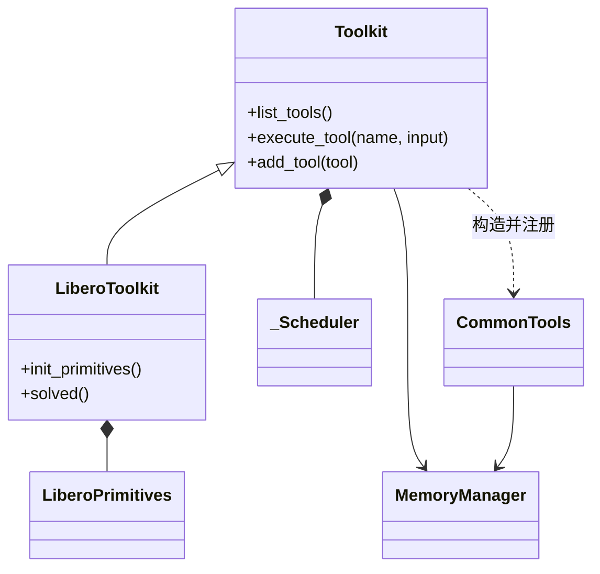
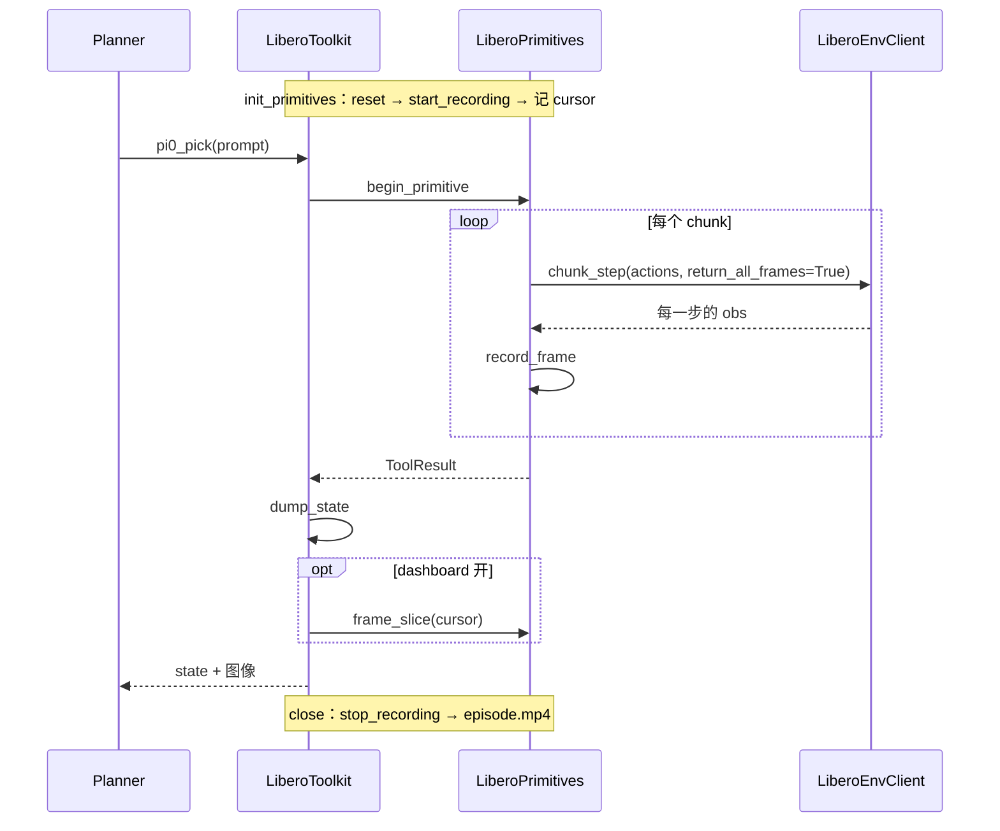

# Code → UML Diagram

两张图分工不重叠：**类图是结构**（有哪些对象、谁创建谁、生命周期），**时序图是一个场景里的行为**
（调用顺序、循环、条件分支）。时序图看不出继承与所有权，类图看不出顺序，所以不互相替代。

默认先画类图，再为 1–3 个关键场景各画一张时序图，参与者只从类图的节点里挑。
用户只点名一种就只画那一种。

读者要拿着图去读代码：**图上每个名字都必须能在源码里 grep 到**，推不出来的关系或消息不画。
在 markdown 里用 Mermaid（`classDiagram` / `sequenceDiagram`）：GitHub、Cursor、VS Code 原生渲染，
diff 是纯文本。节点超过约 12 个、参与者超过约 6 个时布局会挤，拆图，或改用 PlantUML 并提交渲染后的 SVG。

## 1. 先拿骨架

```bash
rg -n '^class |def __init__|^\s+def [a-z]' path/to/module.py
```

范围 = 目标类 + 一跳：它的基类、子类、`__init__` 里存下的对象。再往外的类只在用户点名时画。

## 2. 类图

### 关系只从三处读，各对应一种箭头

| 源码里看到的 | 关系 | Mermaid |
|---|---|---|
| `class B(A)` | 继承 | `A <\|-- B` |
| `__init__` 里 `self.x = X(...)`，自己创建、同生命周期 | 组合 | `A *-- X` |
| `__init__` 参数传入后存成 `self.x` | 关联（注入） | `A --> X` |
| 方法里构造后交出去、不存成字段（如注册进表） | 依赖 | `A ..> X : 构造并注册` |

`import` 不是关系；`TYPE_CHECKING` 下的导入只在它被存成字段时才画。
在别的方法里创建并存成字段的对象（如 `init_primitives()` 里 `self._p = P(...)`）也算组合。

### 每个类只列调用方会用的方法

3–4 个，取上层真正调用的那几个，签名只写到能区分用途（`execute_tool(name, input)`）。
私有 helper、属性 getter、`__repr__` 不列。纯数据类只写类名。

### 图下面写 2–3 条事实

先一句图例（实线箭头 = 持有、空心三角 = 继承、虚线 = 构造后交出），再写图表达不了的：
谁创建、谁注入、谁和谁共享同一个实例、哪个字段可能是 `None`。

## 3. 时序图

### 一张图一个场景

场景是一次用户可见的操作：一次工具调用、一个请求、一次 `reset`。先写一句「这张图回答什么」
放在图上方。两个场景混在一张图里，读者分不清哪条消息属于哪次调用。

### 参与者与消息

- 参与者取类图里的节点，用 `participant T as LiberoToolkit` 起短别名；进程边界（RPC、子进程）
  在别名或 `Note` 里标出来。
- 消息名 = 源码里的方法名，参数只留区分用途的那个。从入口方法沿调用链往下展开，
  **再往下拆不会多出参与者或改变顺序，就停**；纯计算的 helper 不画。
- 返回箭头 `-->>` 只在返回值被下一步用到时画。

### 循环、分支与生命周期

- 源码里的循环画 `loop`，条件分支画 `alt` / `opt`，标签写源码里的条件（`opt dashboard 开`）。
  **条件执行的步骤不能画成每次都发生。**
- 场景之外但决定它能成立的步骤（初始化时打开录像、关闭时落盘）用 `Note over` 放在图首尾，
  不画成消息。

### 图下面写「为什么是这个顺序」

每条一句：某一步为什么必须在这个对象里、为什么在这个时刻。代码或注释写明的直接陈述；
从调用结构推出来的要标出是推断。

## 样例

类图：



- `Toolkit.__init__` 自己创建 `_Scheduler`；`MemoryManager` 由调用方传入，`CommonTools` 拿到的是同一个实例。

时序图（一次 `pi0_pick` 工具调用；帧按 env step 攒、按工具调用切）：



- 帧缓冲在 `LiberoPrimitives` 里，因为只有它经过每个 env step；`LiberoToolkit` 只看得到调用的首尾（推断）。

## 陷阱

- **注入和组合最容易画反。** 判据只有一个：对象是在这个类里 `X(...)` 出来的，还是从参数拿到的。
- **注册表不是组合。** `self._tools: dict[str, Tool]` 画成 `--> Tool : 注册表`，不要把每个工具类都拉进图。
- **回调不画成边。** 把 `self.raise_if_cancelled` 这类方法传给下游，在图下面一句话说明，不新增节点；
  时序图里它被调用、且改变流程（如取消）时才画成消息。
- **时序图不是调用栈。** 每个 helper 都画一条消息，图就退化成 trace，顺序反而看不清。
- Mermaid 里泛型写 `Tool~T~`；类名带下划线（`_Scheduler`）可以直接用。

## 自检

- 每个类名、方法名、消息名能直接 grep 到吗？
- 类图每条边、时序图每条消息，能指出是哪一行建立的吗？指不出来就删。
- 有没有把 `import` 或类型注解画成了关系？
- 时序图里条件执行的步骤都在 `opt` / `alt` 里吗？一张图是不是只有一个场景？
- 时序图的参与者都在类图里吗？不在就补进类图，或说明它为什么在范围外。
