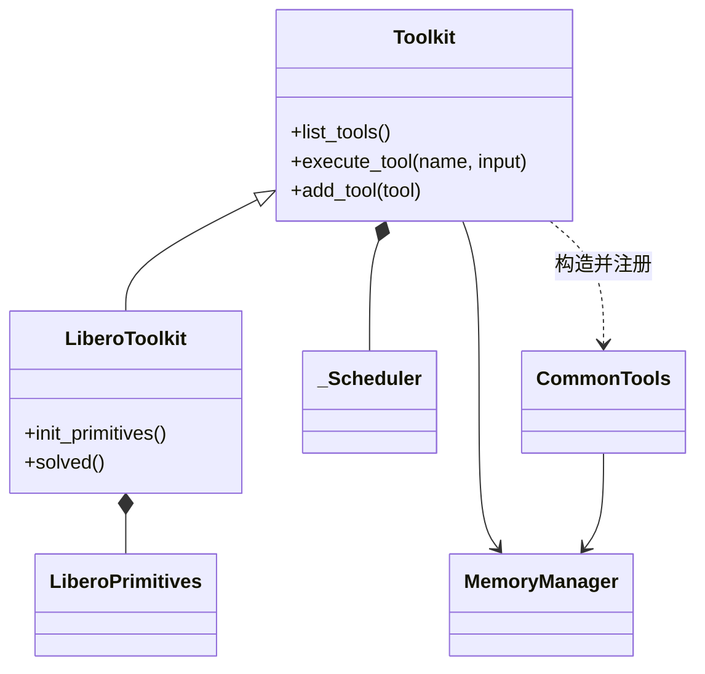
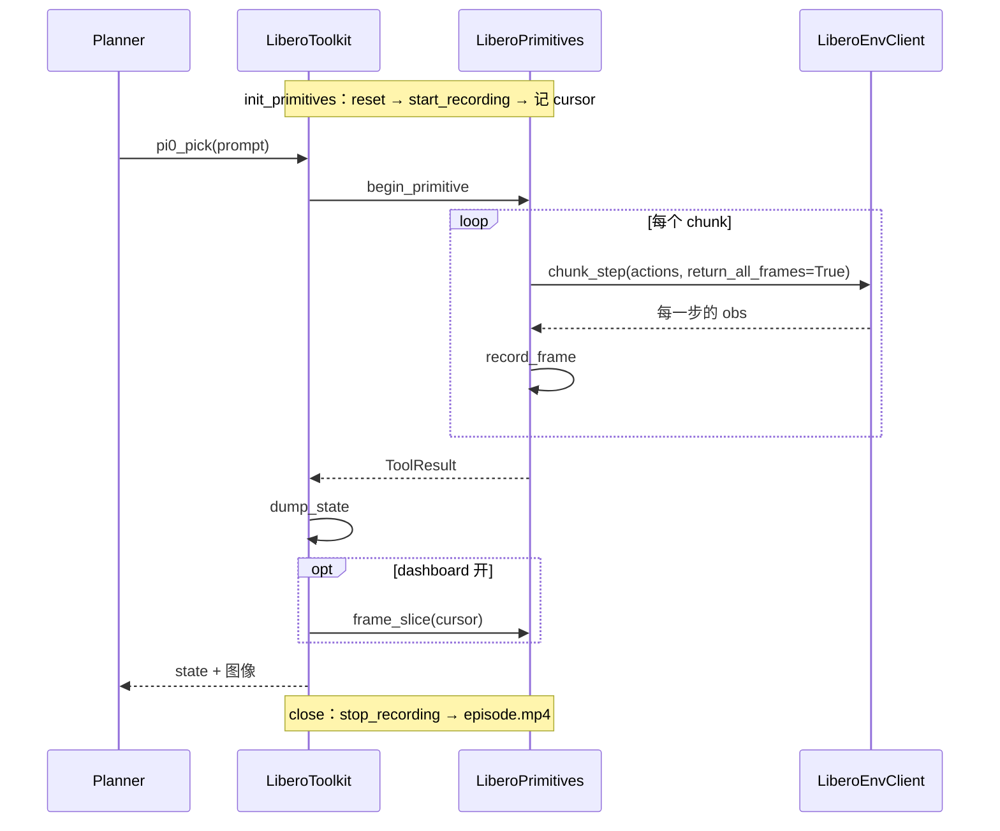

# Reference

主流程见 [SKILL.md](SKILL.md)。

## 样例

类图：

- `Toolkit.__init__` 自己创建 `_Scheduler`；`MemoryManager` 由调用方传入，`CommonTools` 拿到的是同一个实例。

时序图（一次 `pi0_pick` 工具调用；帧按 env step 攒、按工具调用切）：

- 帧缓冲在 `LiberoPrimitives` 里，因为只有它经过每个 env step；`LiberoToolkit` 只看得到调用的首尾（推断）。
